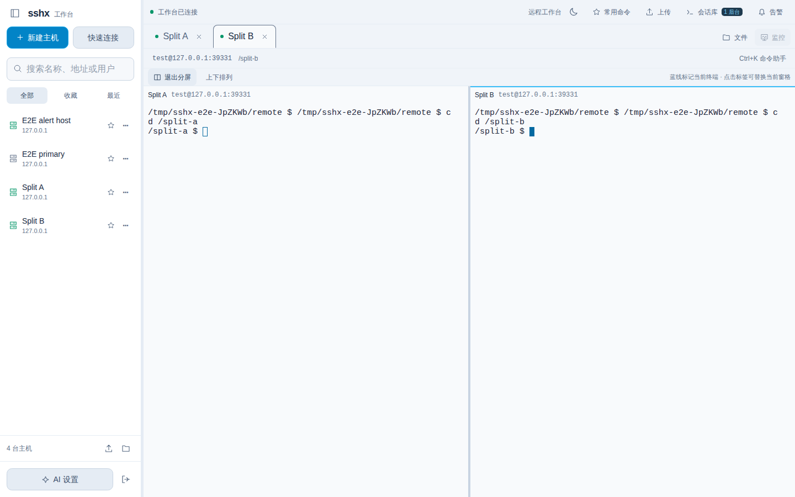
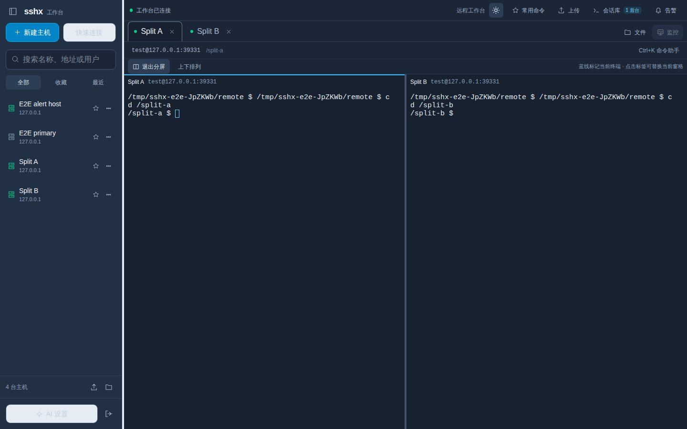

# sshx

面向个人的 SSH 工作台：Go 服务端保持会话，React + xterm.js 提供浏览器终端，配套 SFTP、监控、告警和 AI 工具。

0.3.0 新增可选的远端 tmux 终端恢复，工作台重启后可重新接入原进程。明暗主题、双终端分屏、常用命令和上传队列继续保留。保留会话管理、移动只读、告警、AI 助手与既有安全修复。变化见 [修订记录](docs/CHANGELOG.md)，使用说明见 [产品体验更新](docs/PRODUCT_UPDATE.md)。

[下载 Windows / Linux 版本](https://github.com/doux93/sshd/releases/latest) · [快速开始](docs/QUICKSTART.md)





## 工作台怎么用

需要跨工作台重启保留任务时，在主机高级设置开启“终端保活与恢复（tmux）”。远端需预装 tmux，默认关闭；恢复、断开保留、结束和忘记记录的区别见 [终端恢复指南](docs/TERMINAL_RECOVERY.md)。

- 标签上的 × 只关闭当前视图。打开“会话库”可找回后台会话；“结束会话”是单独确认的操作。
- 主机支持搜索、收藏和最近使用。新建主机先填写地址、用户及认证方式，跳板、代理、监控、告警规则与 AI 权限位于高级设置。
- “测试连接”使用当前表单完成 SSH 身份验证，随后断开，不创建终端或保存主机配置；经明确确认的主机指纹会保留。
- 顶栏切换浅色/深色主题。打开两个会话视图后点击“分屏”，蓝线标记输入目标，可左右或上下排列；小窗口自动上下排列。
- “常用命令”显示当前会话和主机，支持收藏、编辑、删除、复制；复制不自动执行。
- 文件上传显示进度、保存状态及目标路径，可取消或重试。切换会话、收起文件面板不会中断；关闭或刷新整个页面会丢失队列。下载由浏览器管理。
- 主机栏可折叠，主机栏、文件区及监控区可拖动调节尺寸，也支持聚焦分隔条后使用方向键调整。
- 手机上可只读查看输出、监控与告警。只读附着由前后端共同限制输入，手机不会改变桌面终端尺寸。
- 告警历史保存在服务端，最多保留最近 1,000 条，支持翻页、确认及定位关联主机。告警页可主动启用当前设备通知。
- Ctrl+K 展示目标主机、命令、解释及影响；终端输出默认不发送，勾选后最多附带 16 KiB。

主题、常用命令、收藏、最近使用、布局与打开的视图保存在当前浏览器；SSH 会话及告警由服务端保存。关闭视图后的无附着会话仍受 `--session-ttl` 回收策略约束。

## 构建

需要 Go 1.26.3 或更新版本、Node.js 22 或 24、npm。本次使用 Node.js 24 验证。

```sh
cd web
npm ci
npm test
npm run build
cd ..
go test -race ./...
go vet ./...
go build -o sshx ./cmd/sshx
```

Windows 可使用 `go build -o sshx.exe ./cmd/sshx`。`-race` 需要受支持的平台和 C 工具链。
源码压缩包不包含前端依赖目录及构建产物，首次执行 Go 构建前请先完成前端构建。源码不带 Git 信息时可使用 `go build -buildvcs=false`。

## 浏览器验收与下载

固定下载见 [Releases](https://github.com/doux93/sshd/releases/latest)：`sshx-Windows-amd64.zip` 和 `sshx-Linux-amd64.zip`，每份附 SHA-256 校验文件。Windows 解压后双击 `sshx.exe`，会尝试打开默认浏览器；使用期间保留控制台窗口。

[GitHub Actions](https://github.com/doux93/sshd/actions/workflows/verify.yml) 在 Linux 和 Windows 上完成测试、构建及桌面/手机尺寸 Chromium 验收后才发布。开发版只保留 14 天的 Actions 附件，不覆盖已有正式版本。手机模拟不代表真机或推送已验收，详细结果见 [验证记录](docs/VALIDATION.md)。

本地复现浏览器验收（Node.js 24）：

```sh
mkdir -p .testbin
go build -o .testbin/sshx ./cmd/sshx
go build -o .testbin/fakesshd ./_fakesshd
cd web
npx playwright install chromium
npm run test:e2e
```

Windows 构建上述两个程序时添加 `.exe` 后缀。浏览器测试只使用临时数据库、本机测试 SSH 服务和模拟模型服务；测试结束后清理。Windows 原生凭据库测试通过 `SSHX_TEST_SYSTEM_KEYRING=1 go test ./internal/vault` 显式启用，使用独立随机凭据并在测试后删除。

## 本地模式

```sh
./sshx
```

默认监听 `127.0.0.1:8722`，打开控制台打印的带 Token 地址。Windows 默认打开浏览器，`--open-browser=false` 可关闭；`--version` 查看版本和提交。Token 在本次服务进程存活期间有效，并非用一次即销毁。本地模式仅允许数字形式的回环地址；凭据使用系统钥匙串。

开发时先构建一次前端，再分别运行 `go run ./cmd/sshx` 与 `cd web && npm run dev`。打开 Vite 地址时携带后端打印的 Token。

## 常开模式

首次启动通过仅服务用户可读的一次性文件设置主密码（8–1024 字节）。初始化成功后删除该文件；失败时保留，以便排查和重试。

```sh
./sshx --mode remote \
  --addr 127.0.0.1:8722 \
  --data /var/lib/sshx/sshx.db \
  --master-password-file /var/lib/sshx/master-password
```

浏览器通过 HTTPS 反向代理访问。远程模式默认设置 Secure Cookie；仅在回环 HTTP 测试时使用 `--secure-cookies=false`。反向代理需保留原始 Host，详见 [部署说明](docs/DEPLOYMENT.md)。

进程重启后需重新输入主密码解锁凭据库。浏览器断开不会立即关闭 SSH 会话；**普通 SSH 终端不能跨重启恢复；启用 tmux 的终端可在远端进程仍存活时，从会话库重新接入**。默认无浏览器附着 24 小时后回收 SSH 连接，可通过 `--session-ttl` 调整；tmux 远端任务和恢复记录继续保留。

## AI 与 MCP

- `readonly`（默认）：允许 `inspect_system`、文件读取、近期终端输出和监控等固定只读工具；拒绝任意 Shell 命令和文件写入。
- `confirm`：只读工具可用；写操作返回 `confirm-needed`，需要操作者在终端手动处理。目前没有自动审批与恢复执行队列。
- `trusted`：允许任意 Shell 命令及文件写入，仅用于明确授权的节点。
- Ctrl+K 提供命令预览、解释、影响说明与复制，不自动发送到终端。返回值含换行或控制字符时会被拒绝，模型的说明也不作为自动放行依据。
- MCP 端点为 `/api/mcp`，调用工具需在参数中包含已保存节点的 `nodeId`，并事先连接该节点。认证使用 `X-Auth-Token`。

当前 MCP 为基础 JSON-RPC HTTP 实现，协议版本标记为 `2024-11-05`，尚未完整实现 Streamable HTTP，未验证所有外部 MCP 客户端的兼容性。

## 数据与测试边界

- 配置、主机指纹和加密凭据保存在 SQLite；本地模式的凭据保存在系统钥匙串。
- SFTP 上传采用临时文件加重命名提交；失败时保留原文件。服务器不支持原子覆盖时会报错，不先删除旧文件。
- 终端重连重放的是最多 1 MiB 原始输出，并非完整 VT 屏幕快照。历史输出超过缓冲区或复杂全屏程序仍可能需要重绘。
- 命令输出上限为每个流 1 MiB，AI 文件读取上限为 1 MiB，任意命令最长运行 2 分钟。
- OpenSSH 符号链接及原子上传集成测试在有 `/usr/lib/openssh/sftp-server` 的环境运行；缺少该程序时会明确跳过。

## 模块

| 模块 | 职责 |
|---|---|
| `internal/session` | 会话、终端缓冲、附着与尺寸协商 |
| `internal/sshclient` | SSH、SFTP、代理、超时和连接资源 |
| `internal/connect` | 节点拨号、跳板、凭据和主机指纹确认 |
| `internal/store` / `vault` | 配置持久化与凭据存取 |
| `internal/auth` / `server` | 登录、HTTP/WebSocket 和功能装配 |
| `internal/tool` / `mcp` / `llm` | 工具权限、外部工具接口、命令生成 |
| `internal/monitor` / `alert` / `push` | 指标采集、告警与通知 |
| `web` | 浏览器界面及 PWA |
