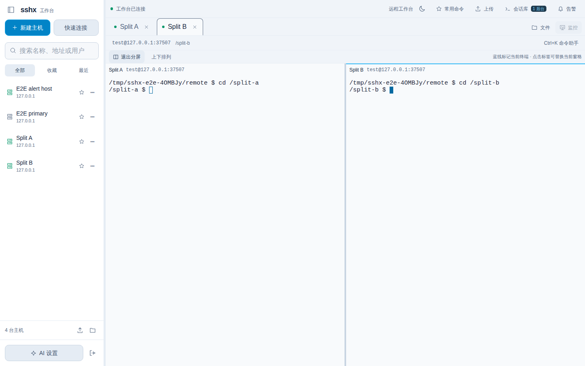
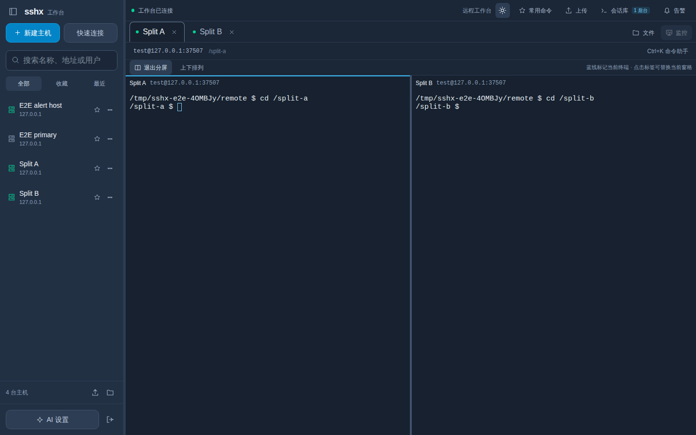
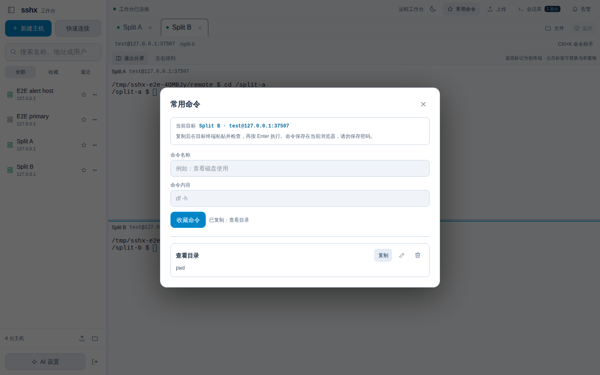
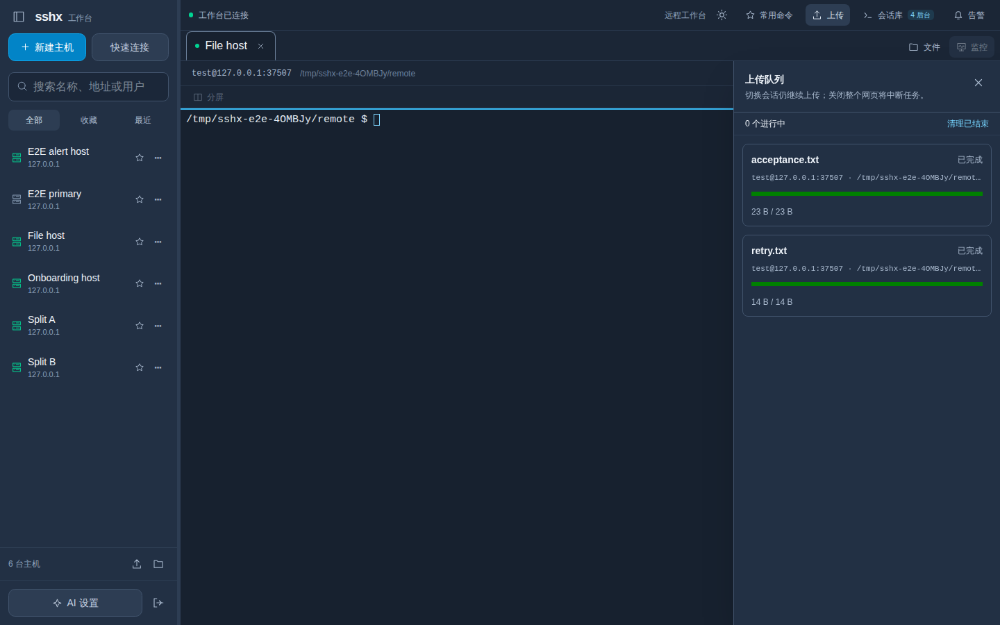

# 产品体验更新

0.2.1 包含 0.2.0 的界面与工作流更新，并补齐被包装的私钥文件错误提示。在现有会话、告警与 AI 流程上增加了以下日常使用能力。

## 主题与分屏

顶栏太阳/月亮按钮切换浅色和深色主题，选择保存在当前浏览器。深色采用较亮的蓝灰底色，终端颜色随主题同步更新，不重新建立 SSH 连接或附着。

打开至少两个会话视图后点击“分屏”。支持左右和上下排列，小窗口自动上下排列。蓝线标识当前输入目标，点击任一终端聚焦；点击其他会话标签会替换当前窗格。没有广播输入。退出分屏收起另一个视图，SSH 会话继续运行。排列方向会记忆，刷新后默认回到单窗格。

“常用命令”可添加、编辑、删除和复制单行命令，并显示当前会话名称与连接目标。它保存在当前浏览器，不跨设备同步，不应存入密码。复制不会向终端发送任何字符，仍需自行粘贴检查并按 Enter 执行。

## 上传队列

文件面板选择或拖入多个文件后，上传队列逐项处理，显示原目标主机、目录和进度。请求体发送完毕后进入“正在保存到主机”，收到服务器确认后才显示“已完成”。关闭文件面板或切换会话不会更改上传目标。

可取消等待中或进行中的任务，失败及取消后可重试。取消发生在服务端提交的瞬间时，文件可能已经保存，需要刷新目标目录确认。队列只在当前页面存活，不支持刷新后恢复或断点续传；下载仍由浏览器管理。

## 安装与首次连接

Releases 提供 Windows/Linux amd64 ZIP 和 SHA-256 校验文件。Windows 双击程序后尝试打开默认浏览器；Linux 控制台运行，桌面环境可用 `--open-browser`。保留控制台窗口以维持本地服务。

新增“保存并连接”，首次使用可依次填写主机、测试与核对指纹、保存并连接。认证、DNS、超时、拒绝连接、私钥文件及 Agent 失败会给出对应排查建议。详见 [快速开始](QUICKSTART.md)。

## 会话、视图和手机

保存的主机是连接配置；SSH 会话在服务端运行；标签是当前浏览器打开的视图。

- 标签 ×：仅收起视图。会话仍在服务端，后台数量显示在会话库入口。
- 会话库 → 打开视图：继续查看原会话；已结束会话仍可查看内存中保留的输出。
- 会话库 → 结束会话：单独确认后关闭 SSH，所有设备对此会话的查看都会结束。
- 会话库 → 重新连接：使用保存的主机配置创建新会话，无法复活旧进程。
- 手机：使用 DOM 渲染终端，避免高像素密度下的 WebGL 空白问题；只读查看、滚动和复制输出，不发送输入、不改变 PTY 尺寸。只读附着在前后端都有限制。

活动视图切换时会重新附着并回放输出。原始输出缓冲仍为最多 1 MiB，未实现完整 VT 屏幕快照。关闭视图后的会话仍受默认 24 小时无附着回收策略约束；服务重启也仍会结束 SSH 会话。

## 日常连接与布局

主机栏支持搜索名称、地址及用户，星标收藏和最近成功连接。文件夹操作位于每行更多菜单。

连接表单默认只显示基础信息，跳板、代理、监控、告警规则及 AI 权限在高级设置中。私钥路径和代理地址均相对于运行 sshx 的机器，远程部署时不读取浏览器所在电脑的文件。

测试连接使用当前表单值；编辑已有主机时，未改写的密码沿用已保存值。测试会完成 SSH 认证并立即关闭，不打开终端、不保存主机配置。首次连接仍须核对指纹；明确接受的指纹会记录到信任库。

主机栏可折叠，三个工作区边界支持拖动，分隔条也支持 Tab 聚焦与方向键调整。会话库和告警使用抽屉，不会继续挤占终端宽度。收藏、最近使用、打开的视图及布局保存在当前浏览器和当前站点，不跨设备同步。

## 告警处理

1. 编辑主机 → 高级设置 → 启用监控 → 添加规则。
2. 保存并重新连接，使采集参数和规则生效。
3. 告警写入服务端历史，保留最近 1,000 条，支持加载更早记录。
4. 告警页点“查看主机与会话”，桌面进入已有活跃会话或显示连接入口；手机定位对应主机和会话列表。
5. “标记已确认”表示已经查看，该标记对工作台所有设备可见，不表示故障已经修复。

浏览器关闭期间发生的事件也会留在历史中。监控依赖活跃 SSH 会话，会话结束后不会继续独立采集。历史仅从本版本启用后开始累积，不会补造旧事件。

Web Push 需要 HTTPS、支持的浏览器/PWA 和通知权限。在告警页主动点击“启用当前设备通知”，点击系统通知会回到对应主机的告警入口。真实移动推送仍需设备验收。

## AI 命令助手

在关联已保存主机的终端按 Ctrl+K，输入需求后查看：

- 服务端返回的实际目标主机及当前会话。
- 单行命令与主要参数说明。
- 可能涉及的文件、服务、权限和其他前提。

命令仅提供复制，始终由用户自行粘贴执行。解释和影响由模型生成，不作为安全验证或执行授权。默认不读取或发送终端上下文；勾选后最多附带最近 16 KiB，备用屏幕模式仍不允许读取。

固定只读工具、人工处理和 trusted 三种工具权限沿用上一版边界。本版本未增加自动审批队列，也未增加自动执行 AI 命令。

## 实际界面

以下截图来自生产构建的 Chromium 验收，终端使用本机测试 SSH 服务。

手机浅色只读终端截图见 [mobile-light.png](images/mobile-light.png)。

## 工程与验证

前端新增 `workspace/`（会话库、告警、通知与偏好）及 `components/`（图标和尺寸调节），与终端、文件、连接树分开维护。告警历史为独立 store 模块及 HTTP handler；草稿测试单独复用连接服务。

详见 [验证记录](VALIDATION.md)。Linux 和 Windows 的自动化检查、生产构建及 Chromium 桌面/手机尺寸浏览器验收均通过；Windows 凭据库实际读写已验证，真实手机与 Web Push 仍需实机验收。
